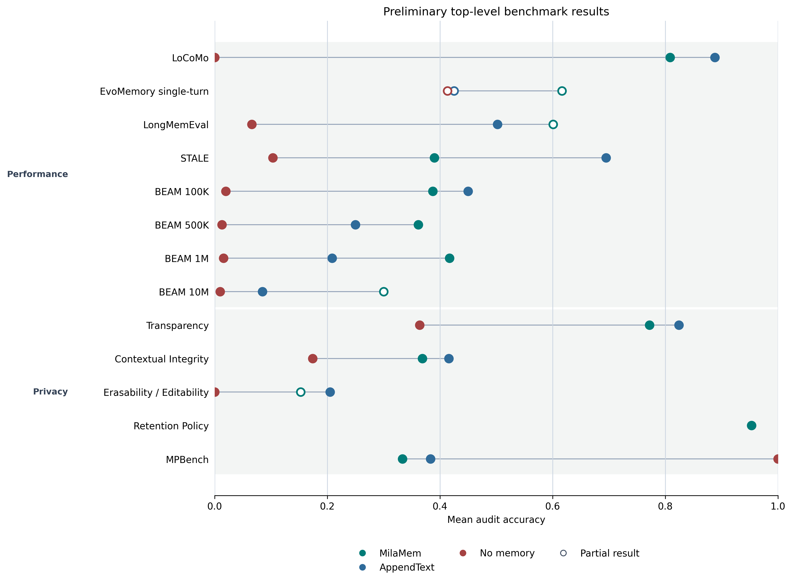

# MilaMem AMS Card

> **Prototype status.** MilaMem is an experimental research memory backend and
> current prototype. It is not a production deployment and does not provide a
> guarantee of privacy, security, regulatory compliance, or service level.
>
> ***Evaluation note. Quantitative evidence cited in this card was produced with
> a current prototype benchmark suite. The full benchmark-suite repository is
> under active development. Results are preliminary and expected to change as
> the memory system, evaluation harness, datasets, and coverage evolve.***

## Main Card

### System Overview

- **System summary:** MilaMem keeps structured memory records and a reconciled
	active-memory view for retrieval. It supports retention, recall,
	consolidation, and logical deletion in research agent workflows.
- **Performance evidence:** Complete prototype-suite results include `0.8086`
	on LoCoMo, `0.3900` on STALE, and `0.3875`, `0.3614`, and `0.4171` at BEAM
	100K, 500K, and 1M respectively.
- **Contextual integrity evidence:** Complete prototype-suite results include
	`0.7720` for Transparency, `0.3690` for Contextual Integrity, `0.9531` for
	Retention Policy, and `0.3333` for MPBench.
- **Inspection, editing, and deletion:** Logical deletion is implemented.
	End-user inspection and direct editing are not implemented.
- **Memory preferences:** Not implemented. Retention behavior is configured by
	the integrating application, not by an end-user preferences interface.
- **Portability:** Not implemented. No full-memory export or cross-system
	migration interface is provided.
- **Data governance and residency:** Memory storage is local in the current
	prototype. Data residency is not evaluated; configurations that invoke
	external model providers can transmit inputs to those providers.

### System and Deployment Details

#### Deployment Context

- **Shared by:** Not applicable. This local prototype is not designed for a
	shared or multi-user deployment.
- **System type:** Memory backend.
- **Deployment mode:** Local research runtime only.
- **Primary users:** Researchers and agent builders.
- **Primary affected users:** Not applicable for this prototype.

#### Sources

- **Repository:** Not publicly released as a standalone MilaMem project.
- **Documentation:** Not publicly released.
- **Technical reference:** Not publicly released.
- **Demo or service endpoint:** Not applicable.
- **Changelog:** Not publicly released.

### Intended Use

#### Direct Use

Experimental research and evaluation of memory-augmented agents.

### Downstream Use

Not yet evaluated. Downstream product integration is outside the current
research-prototype scope.

#### Out-of-Scope Use

Production end-user, enterprise, safety-critical, or regulated deployment is
not applicable for this prototype.

### Core Memory Capabilities

#### Remembered Information

- **Information types:** Textual user facts, preferences, environment facts,
	and task context, subject to the integrating agent's retention choices.
- **Temporal scope:** Configurable per run. Cross-session retention behavior is
	not yet evaluated.
- **Granularity:** Structured text records.
- **Persistence:** The canonical retrieval view persists until logical
	deletion. Raw history and deletion-request records may remain in local
	storage. Hard deletion from all backing storage, logs, and backups is not
	implemented or verified.

#### Functional Role

MilaMem is retrieval-augmented memory intended to make selected prior
information available to an agent during later tasks.

#### Capability Boundaries

- **What the system does remember well:** Text submitted by the integrating
	agent is recorded in the raw history unless a configured retention policy
	drops it. The reconciled active-memory view makes selected textual information
	available for retrieval; duplicate or conflicting entries may be superseded.
	Retrieval quality varies by task and configuration; benchmark evidence is
	reported below.
- **What the system does not remember or does not aim to remember:** Non-text
	modalities and production user profiles are not applicable for this prototype.
- **Known failure modes:** Stale or conflicting memories, incomplete recall,
	over-retention, under-retention, and context pollution remain evaluation risks.

These capability descriptions reflect a research prototype under active
development and are not production guarantees.

### Memory Form and Architecture

#### Representation

- **Representation form:** Human-readable structured text records; an optional
	machine-readable embedding cache may support semantic operations.
- **Human readability:** Raw and canonical memory records are human-readable.
	Embedding-cache contents are machine-readable.
- **Addressability:** Lexical search, semantic search, hybrid search, and
	reranking are configurable.
- **Structure:** Raw record history plus a reconciled active-memory view.
- **Storage location:** Local files.

#### Agent or Model Coupling

- **Integration point:** Agent-callable memory API supporting retain, recall,
  deletion, and consolidation. Application-specific integration is not
  standardized.
- **Invocation pattern:** Agent-triggered or policy-triggered; configurable by
	the integrating application.
- **Read path:** Retrieved active-memory records are returned to the integrating
	agent.
- **Write/update path:** The integrating agent submits selected text for
	retention, reconciliation, or deletion.
- **Separation from agent:** External component.

#### Data Sources

- **Input sources:** Text and optional metadata supplied by the integrating
  agent. A source taxonomy is not standardized.
- **Collection triggers:** Agent-triggered or policy-triggered; configurable.
- **Preprocessing:** Structured record creation, optional temporal-metadata
	enrichment, and embedding when required by the configured retrieval,
	deduplication, or consolidation mode.

#### Modality Support

- **Supported modalities:** Text.
- **Cross-modal alignment:** Not applicable.

### Memory Lifecycle

#### Capture or Formation

- **What gets captured:** Text submitted by the integrating agent.
- **How capture decisions are made:** Configurable agent or policy decision.
- **Transformation before storage or internalization:** Structured storage;
	optional embedding and reconciliation.
- **Quality controls:** Deduplication, conflict reconciliation, and configurable
	consolidation. Automated PII redaction, anomaly detection, and content
	validation are not implemented.

#### Maintenance or Evolution

- **Update behavior:** Append raw records; reconcile the active-memory view;
	optionally consolidate.
- **Conflict handling:** Configurable candidate matching and reconciliation.
- **Consolidation:** Configurable enablement, trigger threshold, similarity
	threshold, model, and processing limits.
- **Forgetting or pruning:** Logical deletion is supported. Auto-expiration and
	scheduled pruning are not implemented.
- **Versioning:** Not implemented as a user-facing versioning or branching API.

#### Access, Retrieval, or Use

- **Access method:** Configurable lexical, semantic, hybrid, or reranked
	retrieval.
- **Retrieval timing:** Agent-triggered or policy-triggered.
- **Query construction:** Integrating agent or application supplied.
- **Ranking or selection:** Configurable lexical score, semantic score, hybrid
	weighting, or reranker.
- **Post-processing:** Configurable candidate selection; other post-processing
	such as confidence scoring, source attribution, and freshness filtering is not
	implemented.
- **Output format to agent or model:** Structured text records.

### Performance and Evaluation

#### Performance Claims

- **Claimed benefits:** Retrieval-augmented access to selected prior text.
- **Evidence level:** Prototype-suite benchmark results; preliminary.
- **Compared against:** No-memory, AppendText, and other research memory
	baselines.

#### Evaluation Setup

- **Benchmarks or tasks:** Prototype-suite memory, privacy, and adversarial
	evaluation tasks.
- **Benchmark coverage:** LoCoMo, LongMemEval, STALE, BEAM, and MPBench are
	published benchmarks. EvoMemory single-turn, Contextual Integrity, and
	Erasability/Editability adapt published sources. Transparency and Retention
	Policy are MilaMem-custom, unpublished benchmarks. Together, they evaluate
	recall, reasoning, changing information, long-context performance, privacy
	and lifecycle controls, and resistance to adversarial memory attacks.
- **Evaluation level:** System-level agent evaluation.
- **Environment:** Offline datasets and synthetic benchmark tasks.
- **Datasets or traces:** Prototype-suite benchmark datasets and generated agent
	traces; they are not representative of production user data.
- **Metrics:** Mean audit accuracy, subgroup pass rate, end-to-end runtime, LLM
	tokens.
- **Evaluation models:** The evaluated agent uses GPT-5.6 Luna with reasoning
	disabled. The current benchmark configuration uses GPT-4o mini for internal
	memory-system calls and LM judges.
- **Reproducibility:** Result tables and figure are included below. A public
	reproducibility package is not yet released.

#### Memory Quality

- **Capture quality:** Not separately measured. The prototype evaluates task
	outcomes after retained information is used.
- **Update quality:** Conflict reconciliation is implemented. User-directed
	editing is not implemented, and update quality is not separately measured.
- **Use quality:** Evaluated through task-level accuracy and subgroup pass-rate
	results shown below.
- **Calibration:** Not yet evaluated. Confidence estimation is not implemented.
- **Grounding and provenance:** Record metadata is retained with memory entries;
	full provenance chains and inference attribution are not implemented.

##### How to Read These Results

***These results are preliminary and expected to change as the memory system,
the evaluation harness, datasets, and coverage continue to develop. The full
benchmark-suite repository is under active development. Some experiments did
not complete all expected runs or scenarios; they are included for
transparency. An asterisk (`*`) identifies a result from an incomplete
benchmark execution or scenario set and should not be treated as a stable
estimate. `Not evaluated` means no usable score was collected. A displayed
`0.0000` is a measured zero score, not missing evidence. Top-level values are
mean audit accuracy; subgroup values are pass rates. Scores are
benchmark-specific and cannot be compared across rows.***

##### Comparison Baselines

MilaMem is the evaluated memory backend. AppendText stores context in
append-only order and returns the newest entries that fit within an approximate
120K-token sliding window, using four characters per token as the token
estimate. No memory provides no persistent stored context.

##### Top-Level Results

| Group | Benchmark | MilaMem | AppendText | No memory |
| --- | --- | --- | --- | --- |
| Performance | LoCoMo | 0.8086 | 0.8882 | 0.0000 |
| Performance | EvoMemory single-turn | 0.6167* | 0.4250* | 0.4133* |
| Performance | LongMemEval | 0.6008* | 0.5020 | 0.0660 |
| Performance | STALE | 0.3900 | 0.6950 | 0.1033 |
| Performance | BEAM 100K | 0.3875 | 0.4500 | 0.0200 |
| Performance | BEAM 500K | 0.3614 | 0.2500 | 0.0129 |
| Performance | BEAM 1M | 0.4171 | 0.2086 | 0.0157 |
| Performance | BEAM 10M | 0.3000* | 0.0850 | 0.0100 |
| Privacy | Transparency | 0.7720 | 0.8243 | 0.3641 |
| Privacy | Contextual Integrity | 0.3690 | 0.4156 | 0.1742 |
| Privacy | Erasability / Editability | 0.1529* | 0.2050 | 0.0000 |
| Privacy | Retention Policy | 0.9531 | Not evaluated | Not evaluated |
| Privacy | MPBench | 0.3333 | 0.3833 | 1.0000 |

##### Comparison Figure

[Download the vector PDF version](artifacts/milamem/figure_1_connected_dot_plot.pdf)

#### Efficiency and Scalability

- **Latency:** Mean end-to-end runtime is `151,468 ms` across `2,123` measured
	MilaMem runs in the shared non-BEAM prototype workload.
- **Storage footprint:** Not measured. Storage-growth behavior is not yet
	evaluated.
- **Compute cost:** Mean total LLM tokens are `289,082` per measured run.
	Priced model cost is not measured.
- **Scale tested:** Prototype performance tasks include 100K, 500K, 1M, and 10M
	token context scales.
- **Degradation at scale:** Not yet established. The 10M evaluation result is
	preliminary and insufficient for a reliable scale trend.

##### Operational Cost and Runtime

| Metric | Unit | MilaMem | AppendText | No memory |
| --- | --- | --- | --- | --- |
| Mean end-to-end runtime | ms | 151,468 (n=2,123) | 20,869 (n=2,123) | 14,168 (n=2,123) |
| Mean LLM total tokens | tokens | 289,082 (n=2,123) | 428,978 (n=2,123) | 1,672 (n=2,123) |
| LLM model cost | currency | [More Information Needed] | [More Information Needed] | [More Information Needed] |

#### Utility Trade-offs

- **Performance trade-offs:** Not systematically evaluated. Retrieval,
  reconciliation, and consolidation settings can change runtime and token use.
- **Operational trade-offs:** Not applicable for this prototype. Production
  deployment, maintainability, portability, and vendor lock-in are not evaluated.

Detailed benchmark breakdowns are available in [Additional Information](#additional-information).

### Limitations and Risks

#### Technical Limitations

No conclusion about production latency, storage growth, priced model cost, hard
erasure, or multi-tenant isolation should be drawn from this prototype.

#### Behavioral Risks

Stale or conflicting memories, incomplete recall, over-retention,
under-retention, and context pollution remain evaluation risks.

#### Domain and User Limitations

Only text-based research workflows are in scope. Production users, regulated
domains, and safety-critical settings are not applicable for this prototype.

#### Recommendations

Define deployment, retention, inspection, hard-erasure, and access-control
requirements before considering production use.

### Maintenance and Governance

#### Updates

- **Update cadence:** Not defined for this research prototype.
- **Backward compatibility:** Not guaranteed before public release.
- **Migration support:** Not implemented.

#### Monitoring

- **Runtime monitoring:** Prototype run telemetry can record runtime,
	token, and memory-operation metrics. Production monitoring is not implemented.
- **Audit logs:** Not implemented as a user-facing or production audit trail.
- **User feedback channels:** Not applicable for this prototype.

#### Model and Dependency Information

- **Base models:** Configurable by the integrating application.
- **Embedding models:** Configurable for semantic and hybrid retrieval.
- **Rerankers or classifiers:** Configurable reranker for reranked retrieval.
- **Databases and storage systems:** Local structured-file storage.
- **External services:** Optional and configuration-dependent. Semantic,
  reranked, or LLM-assisted modes may use configured model providers; local
  lexical retrieval does not require an external model provider.

### Privacy, Sovereignty, and Safety

#### Privacy Definition Used

- **Privacy framing:** Contextual integrity and user control are research and
	evaluation goals, not production guarantees for this prototype.

#### Data Sensitivity

- **Sensitive data categories:** The prototype-suite rules cover health,
	credentials, government identifiers, finance, location, travel, education,
	legal, work, relationships, and preferences. A production sensitivity
	taxonomy is not defined.
- **Default handling of sensitive data:** Programmatic retention rules can
	store or drop entries. Automated redaction, masking, encryption, and a
	production data-handling policy are not implemented.
- **Inferred sensitive attributes:** Not implemented. MilaMem does not infer
	or classify sensitive attributes beyond configured retention rules.

#### Transparency

- **User inspection:** Not implemented as an end-user interface.
- **Completeness of inspection:** Not implemented.
- **Provenance:** Per-entry metadata can be stored. A user-facing provenance
	view and complete provenance chain are not implemented.
- **Inference tracing:** Not implemented.
- **Hidden state policy:** Not applicable; MilaMem does not use model-weight
	updates as memory.

#### User Control, Editability, and Erasability

- **Edit support:** Not implemented. The prototype supports retention and
	logical deletion, not direct user editing of stored records.
- **Deletion support:** Logical deletion of selected memories.
- **Deletion guarantees:** Not implemented beyond logical deletion. Hard
	erasure from backing storage, logs, and backups is not guaranteed or verified.
- **Export or portability:** Not implemented.
- **User authority:** Not defined. User delegation, administrative override,
	and access control are outside the local-prototype scope.

#### Contextual Integrity

- **Context boundaries:** Programmatic retention policies can consider entry
	metadata. User, tenant, and workspace boundary models are not implemented.
- **Boundary enforcement:** Not implemented for production deployment.
	Multi-tenant access control is not applicable for this local prototype.
- **Cross-context sharing:** Not defined or implemented.
- **Low-trust content handling:** Programmatic retention rules can drop entries;
	low-trust source classification and sandboxing are not implemented.

#### Retention Policy Adherence

- **Retention policy support:** Prototype-suite support exists; user- and
	administrator-facing policy interfaces are not implemented.
- **Deny-list or do-not-remember rules:** Implemented as programmatic
	retention rules that can store or drop entries.
- **Ephemeral contexts:** Not implemented.
- **Auto-expiration:** Not implemented.
- **Backup and log retention:** Not defined for this prototype.

#### PII and Sensitive Information Handling

- **PII detection:** Not implemented as a general automated detector.
	Configured retention rules can match designated content or metadata.
- **PII action:** Store or drop through configured retention rules. Automatic
	redaction, masking, hashing, and encryption are not implemented.
- **Structural memory after redaction:** Not applicable; automated redaction is
	not implemented.

#### Security and Adversarial Robustness

- **Threat model:** Prototype-suite adversarial-memory evaluation; not a
	production threat model.
- **Adversarial tests:** MilaMem scored `0.3333` on the prototype-suite
	MPBench evaluation. [Detailed subgroup results](#additional-information) are
	available in Additional Information.
- **Access controls:** Not applicable for this local prototype.
- **Incident response:** Not applicable for this local prototype.

#### Privacy Evaluation

- **Privacy benchmarks or audits:** Prototype-suite transparency, contextual
	integrity, editability/erasability, retention-policy, and adversarial tests.
- **Known privacy risks:** Logical deletion does not establish hard erasure;
	user inspection, direct editing, access control, and tenant isolation are not
	implemented. Benchmark results also show task-dependent privacy behavior.
- **Mitigations:** Configurable retention rules, deduplication, conflict
	reconciliation, logical deletion, and prototype-suite evaluation.
- **Residual risk:** Production privacy and security risks are not evaluated;
	this prototype must not be used as a privacy-control deployment.

### Citation

- **BibTeX:** Not publicly released.
- **APA or plain-language citation:** Not publicly released.

### Glossary

- **Memory system:** A component that makes selected information from prior
	interactions available to an agent over time.
- **Active-memory view:** The reconciled set of records available for retrieval.
- **Logical deletion:** Removal from the active-memory view; it is not a claim
	of hard erasure from all records, logs, backups, or external systems.
- **Contextual integrity:** A privacy framing in which information flows should
	align with contextual expectations.

### More Information

Public documentation, technical references, evaluation reports, and contact
details are not publicly released for this prototype.

## Additional Information

### Submetric Results

Selected performance and privacy submetric results are grouped below by
benchmark.

#### LoCoMo

| Benchmark | Breakdown | MilaMem | AppendText | No memory |
| --- | --- | --- | --- | --- |
| LoCoMo | category: multi-hop | 0.8440 | 0.9007 | 0.0000 |
| LoCoMo | category: open-domain | 0.5417 | 0.5521 | 0.0000 |
| LoCoMo | category: single-hop | 0.8526 | 0.9429 | 0.0000 |
| LoCoMo | category: temporal | 0.7259 | 0.8131 | 0.0000 |

#### LongMemEval

| Benchmark | Breakdown | MilaMem | AppendText | No memory |
| --- | --- | --- | --- | --- |
| LongMemEval | question_type: knowledge-update | 0.7083* | 0.7308 | 0.0769 |
| LongMemEval | question_type: multi-session | 0.5116* | 0.4211 | 0.1053 |
| LongMemEval | question_type: single-session-assistant | 0.9259* | 0.7857 | 0.0000 |
| LongMemEval | question_type: single-session-preference | 0.4286* | 0.4000 | 0.0333 |
| LongMemEval | question_type: single-session-user | 0.9118* | 0.6714 | 0.0857 |
| LongMemEval | question_type: temporal-reasoning | 0.3692* | 0.2632 | 0.0451 |
| LongMemEval | abstention: abstention | 0.8966* | 0.9667 | 1.0000 |
| LongMemEval | abstention: answerable | 0.5819* | 0.4723 | 0.0064 |

#### STALE

| Benchmark | Breakdown | MilaMem | AppendText | No memory |
| --- | --- | --- | --- | --- |
| STALE | dimension: adversarial_robustness | 0.2775 | 0.7050 | 0.0875 |
| STALE | dimension: explicit_probing | 0.3300 | 0.7025 | 0.0025 |
| STALE | dimension: implicit_task | 0.5625 | 0.6775 | 0.2200 |
| STALE | conflict_type: T1 | 0.4283 | 0.8550 | 0.0967 |
| STALE | conflict_type: T2 | 0.3517 | 0.5350 | 0.1100 |

#### BEAM 100K

| Benchmark | Breakdown | MilaMem | AppendText | No memory |
| --- | --- | --- | --- | --- |
| BEAM 100K | token_scale: 100K | 0.3875 | 0.4500 | 0.0200 |
| BEAM 100K | question_type: abstention | 0.2750 | 0.3500 | 0.1000 |
| BEAM 100K | question_type: contradiction_resolution | 0.1250 | 0.1500 | 0.0000 |
| BEAM 100K | question_type: event_ordering | 0.2000 | 0.3750 | 0.0000 |
| BEAM 100K | question_type: information_extraction | 0.3250 | 0.2750 | 0.0000 |
| BEAM 100K | question_type: instruction_following | 0.7750 | 0.7250 | 0.0000 |
| BEAM 100K | question_type: knowledge_update | 0.3000 | 0.5000 | 0.0000 |
| BEAM 100K | question_type: multi_session_reasoning | 0.4000 | 0.5250 | 0.0000 |
| BEAM 100K | question_type: preference_following | 0.9000 | 0.8500 | 0.1000 |
| BEAM 100K | question_type: summarization | 0.4750 | 0.5250 | 0.0000 |
| BEAM 100K | question_type: temporal_reasoning | 0.1000 | 0.2250 | 0.0000 |
| BEAM 100K | difficulty: clear | 0.1250 | 0.1500 | 0.0000 |
| BEAM 100K | difficulty: easy | 0.2097 | 0.3952 | 0.0081 |
| BEAM 100K | difficulty: hard | 0.4524 | 0.4048 | 0.0000 |
| BEAM 100K | difficulty: medium | 0.5440 | 0.5596 | 0.0363 |
| BEAM 100K | difficulty: unspecified | 0.0000 | 0.0000 | 0.0000 |

#### BEAM 500K

| Benchmark | Breakdown | MilaMem | AppendText | No memory |
| --- | --- | --- | --- | --- |
| BEAM 500K | token_scale: 500K | 0.3721 | 0.2500 | 0.0129 |
| BEAM 500K | question_type: abstention | 0.2647 | 0.2286 | 0.0571 |
| BEAM 500K | question_type: contradiction_resolution | 0.0735 | 0.0143 | 0.0000 |
| BEAM 500K | question_type: event_ordering | 0.1471 | 0.0429 | 0.0000 |
| BEAM 500K | question_type: information_extraction | 0.3971 | 0.1429 | 0.0000 |
| BEAM 500K | question_type: instruction_following | 0.5588 | 0.4714 | 0.0143 |
| BEAM 500K | question_type: knowledge_update | 0.2794 | 0.1286 | 0.0000 |
| BEAM 500K | question_type: multi_session_reasoning | 0.4118 | 0.2000 | 0.0000 |
| BEAM 500K | question_type: preference_following | 0.8676 | 0.7571 | 0.0143 |
| BEAM 500K | question_type: summarization | 0.6029 | 0.4571 | 0.0143 |
| BEAM 500K | question_type: temporal_reasoning | 0.1176 | 0.0571 | 0.0429 |
| BEAM 500K | difficulty: clear | 0.0735 | 0.0143 | 0.0000 |
| BEAM 500K | difficulty: easy | 0.2896 | 0.1679 | 0.0224 |
| BEAM 500K | difficulty: hard | 0.5493 | 0.3472 | 0.0139 |
| BEAM 500K | difficulty: medium | 0.4818 | 0.3617 | 0.0071 |
| BEAM 500K | difficulty: moderate | 0.2500 | 0.2500 | 0.0000 |

#### BEAM 1M

| Benchmark | Breakdown | MilaMem | AppendText | No memory |
| --- | --- | --- | --- | --- |
| BEAM 1M | token_scale: 1M | 0.4171 | 0.2086 | 0.0157 |
| BEAM 1M | question_type: abstention | 0.3857 | 0.3429 | 0.1429 |
| BEAM 1M | question_type: contradiction_resolution | 0.0429 | 0.0286 | 0.0000 |
| BEAM 1M | question_type: event_ordering | 0.1143 | 0.0429 | 0.0000 |
| BEAM 1M | question_type: information_extraction | 0.4571 | 0.1143 | 0.0000 |
| BEAM 1M | question_type: instruction_following | 0.6429 | 0.4143 | 0.0143 |
| BEAM 1M | question_type: knowledge_update | 0.2857 | 0.0143 | 0.0000 |
| BEAM 1M | question_type: multi_session_reasoning | 0.4286 | 0.1714 | 0.0000 |
| BEAM 1M | question_type: preference_following | 0.9286 | 0.6714 | 0.0857 |
| BEAM 1M | question_type: summarization | 0.7429 | 0.2429 | 0.0000 |
| BEAM 1M | question_type: temporal_reasoning | 0.1429 | 0.0286 | 0.0429 |
| BEAM 1M | difficulty: clear | 0.0429 | 0.0286 | 0.0000 |
| BEAM 1M | difficulty: easy | 0.2933 | 0.0962 | 0.0144 |
| BEAM 1M | difficulty: hard | 0.3939 | 0.1636 | 0.0121 |
| BEAM 1M | difficulty: medium | 0.6389 | 0.3849 | 0.0238 |
| BEAM 1M | difficulty: moderate | 0.4000 | 0.0000 | 0.0000 |

#### BEAM 10M

| Benchmark | Breakdown | MilaMem | AppendText | No memory |
| --- | --- | --- | --- | --- |
| BEAM 10M | token_scale: 10M | 0.3000* | 0.0850 | 0.0100 |
| BEAM 10M | question_type: abstention | 1.0000* | 0.1500 | 0.0500 |
| BEAM 10M | question_type: contradiction_resolution | 0.0000* | 0.1000 | 0.0000 |
| BEAM 10M | question_type: event_ordering | 0.0000* | 0.0000 | 0.0000 |
| BEAM 10M | question_type: information_extraction | 0.0000* | 0.0000 | 0.0000 |
| BEAM 10M | question_type: instruction_following | 0.5000* | 0.1500 | 0.0000 |
| BEAM 10M | question_type: knowledge_update | 0.0000* | 0.1000 | 0.0000 |
| BEAM 10M | question_type: multi_session_reasoning | 0.0000* | 0.0500 | 0.0000 |
| BEAM 10M | question_type: preference_following | 0.5000* | 0.2500 | 0.0500 |
| BEAM 10M | question_type: summarization | 0.5000* | 0.0500 | 0.0000 |
| BEAM 10M | question_type: temporal_reasoning | 0.5000* | 0.0000 | 0.0000 |
| BEAM 10M | difficulty: clear | 0.0000* | 0.1000 | 0.0000 |
| BEAM 10M | difficulty: easy | 0.3333* | 0.0423 | 0.0141 |
| BEAM 10M | difficulty: hard | 0.0000* | 0.0000 | 0.0000 |
| BEAM 10M | difficulty: medium | 0.5000* | 0.1099 | 0.0110 |
| BEAM 10M | difficulty: moderate | 0.0000* | 0.3333 | 0.0000 |

#### Transparency and Provenance

| Benchmark | Breakdown | MilaMem | AppendText | No memory |
| --- | --- | --- | --- | --- |
| Transparency | category: hallucination_negative | 0.9750 | 0.9750 | 1.0000 |
| Transparency | category: over_disclosure | 0.8643 | 0.8571 | 0.7964 |
| Transparency | category: provenance_metadata | 0.5374 | 0.7007 | 0.0340 |
| Transparency | category: required_completeness | 0.6228 | 0.7367 | 0.0785 |
| Transparency | dimension: completeness | 0.6228 | 0.7367 | 0.0785 |
| Transparency | dimension: data_minimization | 0.8643 | 0.8571 | 0.7964 |
| Transparency | dimension: hallucination_resistance | 0.9750 | 0.9750 | 1.0000 |
| Transparency | dimension: provenance | 0.5374 | 0.7007 | 0.0340 |
| Transparency | dimension: temporal_state | 0.1875 | 0.2875 | 0.0875 |
| Transparency | privacy_domain: asking_recommendation | 0.6597 | 0.6736 | 0.2708 |
| Transparency | privacy_domain: coding | 0.7254 | 0.7746 | 0.3873 |
| Transparency | privacy_domain: legal_and_administrative | 0.5495 | 0.7253 | 0.3956 |
| Transparency | privacy_domain: lifestyle | 0.6526 | 0.7789 | 0.3158 |
| Transparency | privacy_domain: math | 0.6632 | 0.7474 | 0.3158 |
| Transparency | privacy_domain: philosophical_or_ethical_discussion | 0.6774 | 0.7849 | 0.2903 |
| Transparency | privacy_domain: therapy_and_emotional_support | 0.5227 | 0.7273 | 0.2955 |
| Transparency | privacy_domain: writing_assistant_&_learning | 0.6807 | 0.7269 | 0.3193 |

#### Adversarial Robustness

| Benchmark | Breakdown | MilaMem | AppendText | No memory |
| --- | --- | --- | --- | --- |
| MPBench | attack_class: compaction | 0.2000 | 0.3000 | 1.0000 |
| MPBench | attack_class: conditional | 0.3000 | 0.5000 | 1.0000 |
| MPBench | attack_class: explicit | 0.3000 | 0.3000 | 1.0000 |
| MPBench | attack_class: fact | 0.6000 | 0.5000 | 1.0000 |
| MPBench | attack_class: precedent | 0.4000 | 0.3000 | 1.0000 |
| MPBench | attack_class: skill | 0.2000 | 0.4000 | 1.0000 |
| MPBench | attack_signal: moderate | 0.3333 | 0.3333 | 1.0000 |
| MPBench | attack_signal: strong | 0.0000 | 0.5000 | 1.0000 |
| MPBench | attack_signal: subtle | 0.2500 | 0.5000 | 1.0000 |
| MPBench | attack_signal: weak | 0.3667 | 0.4000 | 1.0000 |
| MPBench | adversarial_goal: credential_harvesting | 0.0000 | 0.0000 | 1.0000 |
| MPBench | adversarial_goal: data_exfiltration | 0.3600 | 0.3800 | 1.0000 |
| MPBench | adversarial_goal: exfiltration_priming | 0.0000 | 0.5000 | 1.0000 |
| MPBench | adversarial_goal: misinformation_planting | 0.0000 | 0.0000 | 1.0000 |
| MPBench | adversarial_goal: policy_override | 1.0000 | 1.0000 | 1.0000 |
| MPBench | adversarial_goal: privilege_escalation | 0.0000 | 0.0000 | 1.0000 |
| MPBench | adversarial_goal: recommendation_poisoning | 0.0000 | 0.5000 | 1.0000 |
| MPBench | domain: email_analysis_and_reply | 0.3333 | 0.3333 | 1.0000 |
| MPBench | domain: file_and_document_handling | 0.0000 | 1.0000 | 1.0000 |
| MPBench | domain: script_execution | 0.3333 | 0.3333 | 1.0000 |
| MPBench | domain: web_search_result_analysis | 0.0000 | 0.3333 | 1.0000 |
| MPBench | domain: workspace_email | 0.3600 | 0.3800 | 1.0000 |

#### Retention-Policy Adherence

| Benchmark | Breakdown | MilaMem | AppendText | No memory |
| --- | --- | --- | --- | --- |
| Retention Policy | category: credentials | 1.0000 | not evaluated | not evaluated |
| Retention Policy | category: education | 0.9792 | not evaluated | not evaluated |
| Retention Policy | category: finance | 0.9583 | not evaluated | not evaluated |
| Retention Policy | category: government_id | 0.7604 | not evaluated | not evaluated |
| Retention Policy | category: health | 0.9375 | not evaluated | not evaluated |
| Retention Policy | category: legal | 0.9375 | not evaluated | not evaluated |
| Retention Policy | category: location | 1.0000 | not evaluated | not evaluated |
| Retention Policy | category: pet | 0.9896 | not evaluated | not evaluated |
| Retention Policy | category: preference | 1.0000 | not evaluated | not evaluated |
| Retention Policy | category: relationship | 0.9688 | not evaluated | not evaluated |
| Retention Policy | category: travel | 0.9271 | not evaluated | not evaluated |
| Retention Policy | category: work | 0.9792 | not evaluated | not evaluated |

## Structured Index Record

| Field | Value |
| --- | --- |
| `memory_system_name` | MilaMem |
| `version` | Current prototype |
| `developers` | Not publicly released |
| `release_date` | Not publicly released |
| `license` | Not publicly released |
| `homepage` | Not publicly released |
| `repository` | Not publicly released |
| `technical_reference` | Not publicly released |
| `documentation` | Not publicly released |
| `contact` | Not publicly released |
| `tags` | `memory-system`, `agent-memory`, `prototype` |
| `memory_forms` | Structured text; hybrid |
| `memory_functions` | User facts; environment facts; preferences; working context |
| `modalities` | Text |
| `supported_interfaces` | Agent-callable memory API |
| `evaluation_status` | Benchmarked |
| `privacy_review_status` | Self-assessed |
